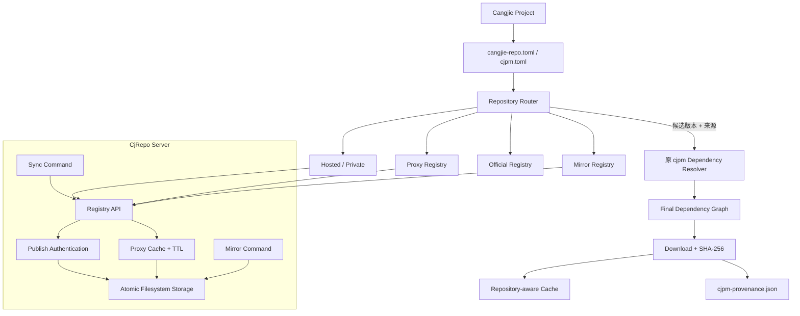
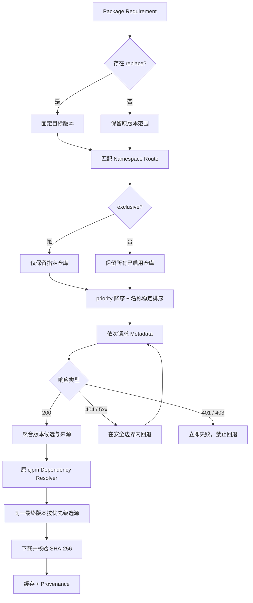

# CjRepoMesh 架构说明

> 更新日期：2026-10-22
> 范围：实现设计与各批历史验证；当前产物身份及实际执行范围统一见[固定候选清单](candidate-acceptance.md)首节，不继承历史平台或产物成绩。
> 原则：Repository Router 只决定候选来源，版本选择继续由原 cjpm 依赖求解器完成

## 1. 官方交付与冲奖增强

| 分类 | 能力 | 当前状态 |
| --- | --- | --- |
| 官方交付 | 多仓配置、优先级查找 | 已实现并有端到端测试 |
| 官方交付 | 多仓解析、冲突处理、`[replace]` 强制替换 | 已复用原求解器并有端到端测试 |
| 官方交付 | 私有中心仓部署 | 当前Linux容器交付与原生核心有验证；Windows为历史记录，当前原生执行暂停 |
| 官方交付 | Hosted、Proxy、Mirror、仓间 Sync | 已实现最小闭环并有端到端测试 |
| 冲奖增强 | 独占命名空间与安全感知回退 | 已实现并有攻击/故障测试 |
| 冲奖增强 | `repo explain`、`repo doctor`、来源持久化 | 已实现并有在线、离线测试 |
| 冲奖增强 | 并发原子写、Proxy 填充合并和索引 TTL | 已实现并有并发、过期测试 |
| 冲奖增强 | 可重复 Benchmark | 已保留原始样本与 Median/P95 报告 |

## 2. 总体架构



这条链路刻意把两个问题分开：

- Repository Resolution：哪些仓库允许被访问、以什么顺序访问、每个版本来自哪里；
- Dependency Resolution：版本范围、传递依赖、冲突合并和最终依赖图。

前者由 CjRepoMesh 增强，后者继续使用官方 cjpm 原有实现。仓库优先级因此不会错误地覆盖版本求解规则。

## 3. 解析决策流程



核心不变量：

1. 高优先级仓提供 `1.0.0`、低优先级仓提供 `2.0.0` 时，只要原版本范围允许，仍由原求解器选择 `2.0.0`；
2. 多个仓都提供最终选中的同一版本时，才按仓库优先级确定下载来源；
3. `401/403`、独占路由和校验失败不能通过访问公共仓被绕过；
4. `[replace]` 固定版本，但不能绕过路由、认证和完整性边界。

## 4. CjRepo Server

服务端保持为单个仓颉进程和文件系统存储，避免为比赛引入数据库、缓存集群或消息队列。

### 4.1 cjpm 兼容接口

| 方法 | 路径 | 用途 |
| --- | --- | --- |
| `GET` | `/health` | 健康检查 |
| `POST` | `/pkg/<package>` | 发布 Hosted 包 |
| `GET` | `/index/<prefix>/<package>` | 查询包版本元数据 |
| `GET` | `/pkg/<package>/<version>` | 下载版本化制品 |

### 4.2 存储和一致性

```text
storage/
├── index/default/<prefix>/<package>
└── artifacts/default/<package>/<version>/<package>-<version>.cjp
```

- 服务端复核客户端提供的 SHA-256；
- 制品和索引使用临时文件加原子替换；
- 进程级存储锁保证并发发布和首次代理填充的一致性；
- 重复发布同一版本返回冲突，不静默覆盖；
- Proxy 只让元数据索引按 TTL 过期，已校验的版本化制品保持不可变缓存；
- Mirror 和 Sync 在写入前均重新验证 SHA-256。
- Sync 先比较源与目标的包索引；目标已有相同校验和版本时仍读取并校验目标制品，通过后不下载源制品；缺失制品可补齐，损坏或读取拒绝明确失败，同版本不同校验和拒绝覆盖；并发发布得到 409 后也重新核对目标索引及制品。
- Hosted 重发可补齐校验和一致的孤立制品或缺失制品；恢复操作位于原有包锁内，保留已存制品或索引内容，完整重复和冲突版本仍拒绝。存储临时文件使用 API 不接受的点号开头名称，避免与以 `.tmp` 结尾的合法包名碰撞。

## 5. 安全边界

| 风险 | 当前控制 |
| --- | --- |
| Dependency Confusion | `exclusive = true` 的命名空间路由，公共仓不会被访问 |
| 认证失败后错误回退 | `401/403` 立即阻断 |
| 下载内容被篡改 | cjpm、Proxy、Mirror、Sync 全链路 SHA-256 校验 |
| 同名同版本跨仓污染 | 仓库维度的缓存与来源映射 |
| 静默强制替换 | 继续使用显式 `[replace]`，并由 `repo explain` 展示 |
| 来源不可追溯 | 原子写入 `cjpm-provenance.json`，支持离线解释 |
| Token 进入配置仓库 | `token-env` 与进程环境变量 |

## 6. 代码地图

| 模块 | 主要位置 | 职责 |
| --- | --- | --- |
| 配置模型 | `cjpm/src/config/central_repository.cj` | 兼容旧单仓配置，解析命名仓库与路由 |
| 多仓客户端 | `cjpm/src/implement/depot.cj`、`central_repository.cj`、`dep_engine.cj` | 仓库路由、认证和下载，聚合各仓候选并保留最终版本来源 |
| 原依赖求解 | `cjpm/src/implement/dep_engine.cj` | 保持官方版本选择与冲突处理语义 |
| Explain / Doctor | `cjpm/src/command/repo.cj`、`cjpm/src/implement/repo.cj` | 解释真实决策和探测仓库状态 |
| 来源记录 | `cjpm/src/implement/provenance.cj` | 原子持久化最终来源和校验和 |
| Hosted | `server/src/hosted.cj` | 发布、查询、下载、鉴权与校验 |
| Proxy | `server/src/proxy.cj` | 按需缓存、TTL、离线命中与上游错误处理 |
| Storage | `server/src/storage.cj` | 文件布局、原子写与并发保护 |
| Mirror / Sync | `server/src/main.cj`、`server/src/sync.cj` | 主动镜像和 CjRepo-to-CjRepo 增量复制 |
| 自动验证 | `integration-tests/run.py`、`run-linux.sh`、`run-all.ps1` | Windows/Linux 共用四组核心语义；Windows 另加部署组 |

## 7. 已知边界

- Hosted 与 Proxy 支持默认仓及 `?organization=<组织名>`，按组织分别存放索引和制品，并拒绝其他查询参数或组织身份不匹配，避免别名到默认仓；Mirror、Sync 的命令与清单可用 `组织名::包名` 选择组织仓；读取鉴权可通过 `CJREPO_READ_TOKEN` 显式启用，默认仍公开读取；
- 发布和代理缓存填充使用固定 256 个锁分片，按仓库、组织和包名定位；同包串行，不同包通常并行，哈希碰撞时仍会串行，且锁对象数量有界；
- 递归创建共享父目录另用一个进程内短时锁，Hosted、Proxy、Mirror/Sync 统一调用；锁内不下载或写制品，不支持多进程共用存储目录；
- Mirror/Sync 已支持显式批量清单与单进程定时轮询，失败项下轮重试；尚无持久化游标、字节级断点续传和多实例协调；
- Windows 一键部署、WSL 2 / Ubuntu 22.04 Linux 原生构建与四组共享核心回归、Docker Compose 真实发布和容器重建持久化均已验证；
- 尚未运行依赖额外官方测试资产的完整 Maple HLT/LLT，因此不能宣称通过全部官方回归；
- `cjpm-provenance.json` 是 CjRepoMesh 的审计文件，不冒充官方 lockfile 格式。
- 在线explain只预览单包候选，明确忽略lockfile和传递约束；recorded读取保存的解析记录，不证明编译成功、来源真实性或当前配置一致性。可选的[CI来源基线](repository-source-baseline.md)在最终仓库图选定后、制品下载前比较独立批准集合，不改变求解器。另有[解包源码缓存一致性校验](cache-integrity.md)，不提供发布者签名、编译产物再验真或脚本沙箱。
- 服务端限制发布制品/元数据、上游索引/制品，并在包锁内限制每组织/包的Hosted发布累计索引字节；旧索引读取有界，追加含分隔符/换行并在新写入前拒绝超限，缺失制品恢复及冲突语义保留。见[操作说明](operations.md)；默认8、范围1–64的单进程发布处理器准入，鉴权后读体前申请，超额429，持有者finally释放；另有进程级制品数组预留预算以及可选的受管文件逻辑字节配额。慢请求仍可占槽，不提供流式落盘、总连接数/精确RSS、操作系统磁盘配额或完整操作总期限。
- TTL过期会重新获取上游索引；预热缓存命中不等于永久离线快照。已实现独立批准包集合的受控快照导出、校验及新卷装入，并支持完整批准按来源拆分集合；快照排除运行配置和未批准包，来源离线后仍须验证受批准的冷构建。它不认证发布者、不支持任意仓库全量镜像，也不提供构建脚本沙箱，当前交付身份及实测范围见[候选入口](candidate-acceptance.md)。

## 8. 证据入口

- Windows 全量验证：`integration-tests/run-all.ps1`
- Linux 共享核心验证：`integration-tests/run-linux.sh`
- 最近一次全量结果：`docs/verification-report.md`
- Linux 原生验证：`docs/linux-verification.md`
- Docker Compose 验证：`docs/docker-verification.md`
- 多仓实现与场景矩阵：`docs/multirepo-implementation.md`
- 官方要求映射：`docs/competition-requirements-matrix.md`
- 获奖就绪度与缺口：`docs/award-readiness.md`
- Proxy 性能报告：`benchmark/results/proxy-benchmark.md`
